# Hearthstone Table

**A browser-based VR tabletop for Dungeons & Dragons, played with your own hands.**

Hearthstone Table gives a Dungeon Master (DM) and players room to create with AI generation, and it keeps them physically involved through hand tracking. The DM hosts a table and players join with a six-letter code. Each player builds a D&D 2024 character sheet, then puts on a Meta Quest and sits at one shared table. In combat the DM calls for a roll, the player throws the dice with their own tracked hands, the DM confirms the result, and the player releases the attack with a hand sign. The DM runs the world live with life-size animated creatures, AI-generated monsters, 3D scenes, weather, music and narration.

> The game supplies the table and the tools. Your group brings the campaign.

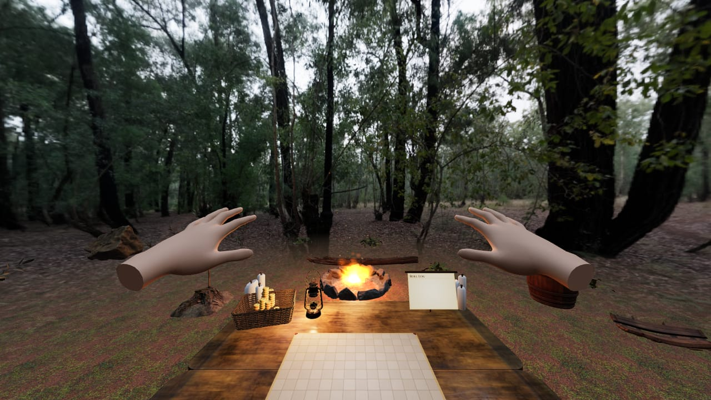

---

## Contents

1. [At a glance](#at-a-glance) · [Field Guide (PDF)](docs/Hearthstone-Table-Field-Guide.pdf)
2. [Try it in five minutes](#try-it-in-five-minutes)
3. [A session, start to finish (with screenshots)](#a-session-start-to-finish)
4. [How a turn works](#how-a-turn-works)
5. [Hand tracking and hand signs](#hand-tracking-and-hand-signs)
6. [The DM's tools](#the-dms-tools)
7. [The character sheet](#the-character-sheet)
8. [The VR interface](#the-vr-interface)
9. [AI Forge](#ai-forge-creatures-only)
10. [Voice chat](#voice-chat)
11. [Controls](#controls)
12. [Playing on a Meta Quest](#playing-on-a-meta-quest)
13. [Project status and roadmap](#project-status-and-roadmap)
14. [Testing and quality (for developers)](#testing-and-quality-for-developers)
15. [How it is built (for developers)](#how-it-is-built-for-developers)
16. [Troubleshooting](#troubleshooting)
17. [Copyright and credits](#copyright-and-credits)

---

## At a glance

| | |
|---|---|
| **Platforms** | Meta Quest 3, 3S, 2 and Pro (Quest Browser), and any desktop or laptop browser (Chrome or Edge recommended) |
| **Input** | Quest hand tracking (no controllers needed), Quest controllers, laptop webcam hands (Google MediaPipe), mouse and keyboard |
| **Players** | One DM and any number of players at one table, each with their own seat, dice tray, character card and satchel |
| **Characters** | D&D 2024 sheet: all 12 classes, species, backgrounds, rolled / standard array / point-buy scores, spells, coins, and a catalogue of 132 preset items |
| **Combat** | Call for a roll → physical dice throw → DM confirms → the player releases the attack with one of 4 hand signs, each paired with one of 32 spell effects |
| **World** | 24 ready-made, rigged and animated creatures placed life-size, 16 conditions, initiative, 8 3D scenes, weather, music, sound effects, lighting, narration, fog of war |
| **AI** | AI Forge: describe a creature, approve the picture, get a 3D model on the map and life-size in the room |
| **Multiplayer** | Join by code or QR, rejoin from another device, positional voice chat (WebRTC) |
| **Quality** | 435 unit tests, 26 browser end-to-end tests, a 60-minute multiplayer soak, a 1,416-case hand-sign test matrix, CI on every push |

**Inspired by** *Demeo x Dungeons & Dragons: Battlemarked* (an official D&D VR game with a shared table but its own scripted adventure) and digital touchscreen D&D tables (shared tables for groups in one room). Hearthstone Table keeps the shared table and lets each group play its own campaign from anywhere.

**Terms used below:** *DM* (Dungeon Master, who runs the game) · *d20* (a twenty-sided die; d4 to d100 likewise) · *HP* (hit points) · *AC* (armour class, what an attack must reach to hit) · *DC* (difficulty class, what a check or saving throw must reach) · *WebXR* (the web standard for VR in browsers) · *IWER* (Meta's emulated headset for testing without one).

---

## Try it in five minutes

**You need:** [Node.js](https://nodejs.org/) 24 (recommended) or 22.12+, Git, and Chrome or Edge on a computer with a graphics card (WebGL 2). A webcam and a Meta Quest are optional. If anything goes wrong, see [Troubleshooting](#troubleshooting).

```bash
git clone https://github.com/Valpixv/hearthstone-table.git
cd hearthstone-table
npm install
npm run dev:http
```

Open **http://localhost:5174** in Chrome or Edge.

**The quickest way to see everything on one computer:**

1. In the first tab, open **Test mode: skip the code and the character stage** at the bottom of the home screen, select **Play as DM**, then click **Desktop**.
2. Open a second tab at the same address, open **Test mode** again, leave **Play as Player** selected, then click **Desktop**.
3. Both tabs are now at the same table. Use the DM tab to drag a creature in, call for a roll, and change the scene; use the player tab to roll and release the attack.

**Guides:**

- **[Play & Test Field Guide (PDF, 21 pages)](docs/Hearthstone-Table-Field-Guide.pdf):** an illustrated, step-by-step guide for players and DMs. It covers starting the server, hosting and joining, building a character, a first encounter from the DM's call to the player's hand sign, webcam and Quest play, the four hand signs, scenes, voice, saving, the Forge, a three-pass playtest (desktop, webcam, headset), troubleshooting and the automated checks.
- **[Test and Validation Plan](docs/TEST-AND-VALIDATION-PLAN.md):** success targets, playtest sessions, key checks, risks and open defects.

**Try VR without a headset:** open `http://localhost:5174/?iwer` to load Meta's Immersive Web Emulator, an emulated Quest 3 with tracked hands that you move with the mouse, then press **Enter VR**. `?iwer=controller` emulates controllers instead.

**The full flow (host, join by code, build a character):** run `npm run dev` instead. It serves `https://localhost:5173` and a network address for other devices; accept the self-signed certificate warning once.

---

## A session, start to finish

### 1. The DM hosts, players join

The home screen offers **Host table** and **Join table**. The DM gets a six-letter table code, a link and a QR code. Players type the code and their name; a player who wants to throw dice with a laptop camera ticks **Use webcam hands**.

| | |
|---|---|
| 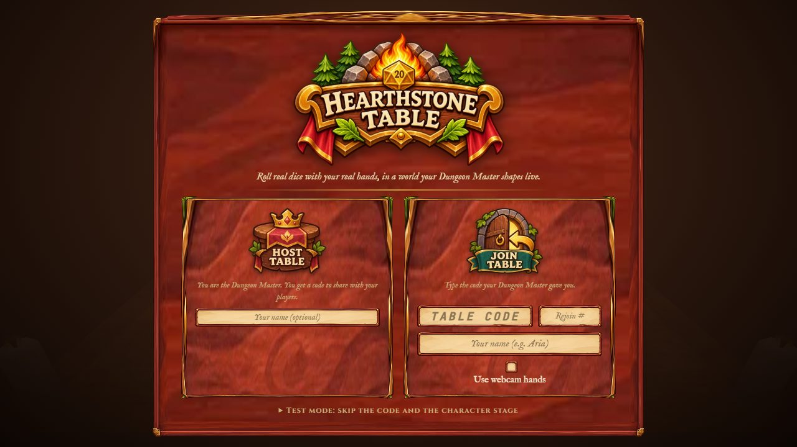 | 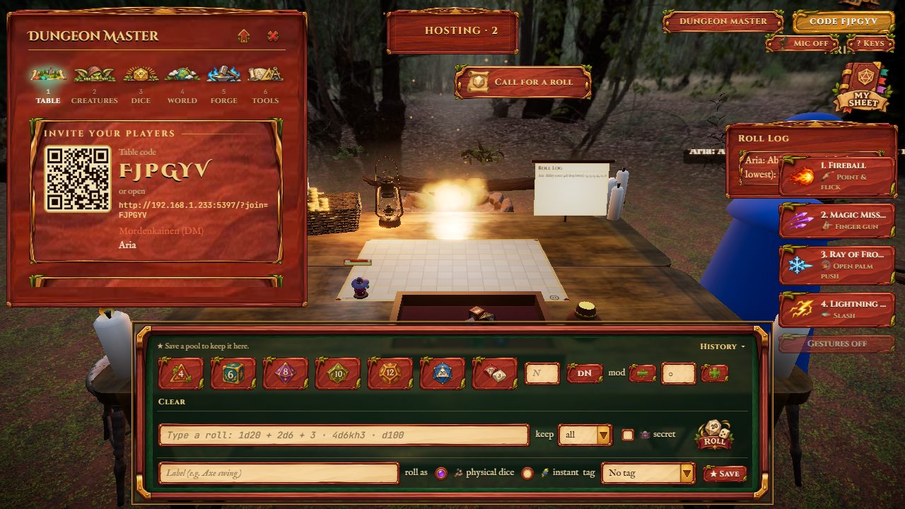 |

### 2. Stage 1: each player builds a character on a desktop

A six-step builder: class, origin (species and background), ability scores (roll 4d6 drop lowest, standard array or point buy), skills and hit points, details and four hand-sign spells, then a review. **Quick build** fills in a complete level 1 character. The DM's Table tab shows every player's progress and who is ready.

| | |
|---|---|
| 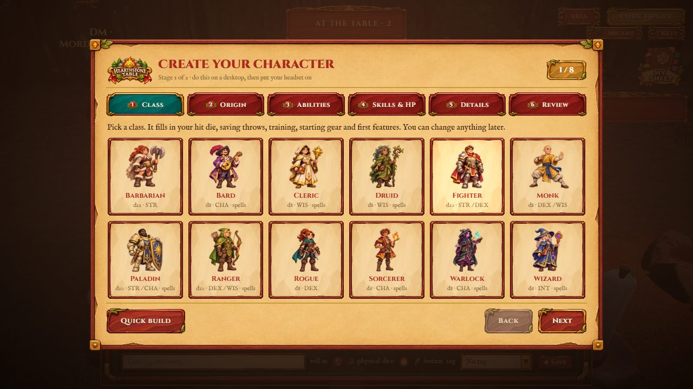 | 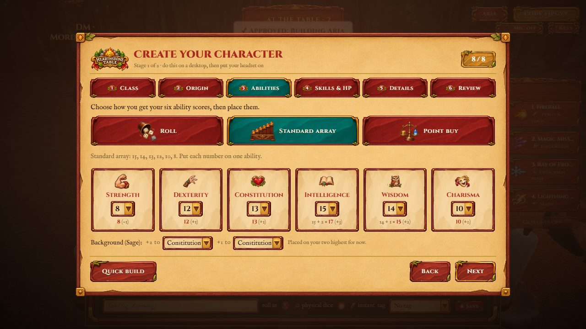 |
| 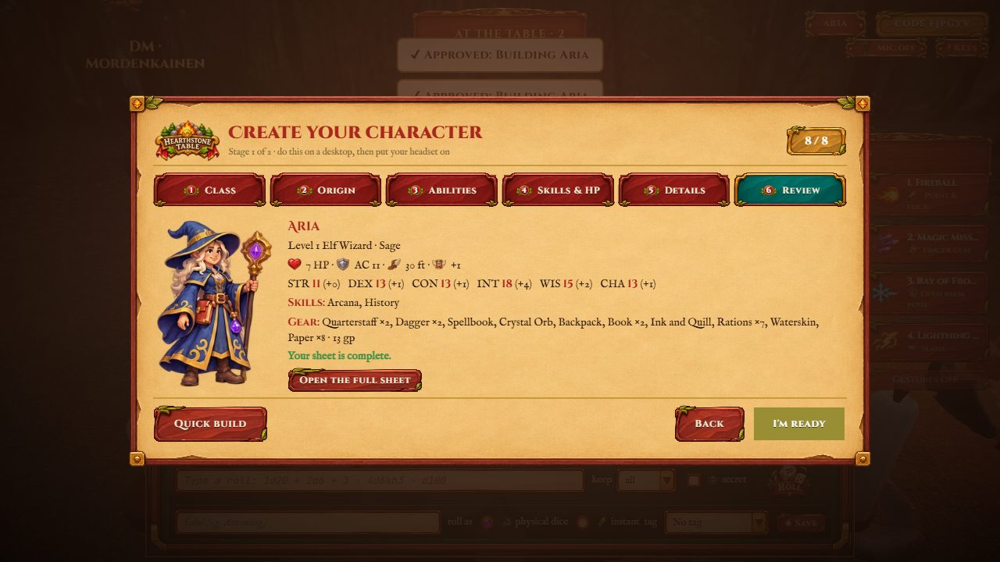 | |

### 3. Stage 2: the adventure begins and players put on their headsets

The DM presses **Begin the adventure**. Each player sees how to continue in VR: **Enter VR** on a tethered headset, or, on a standalone Quest, open the same address and type the table code plus the four-digit **rejoin number** shown on their desktop. Their character and seat follow them. Staying on a desktop also works.

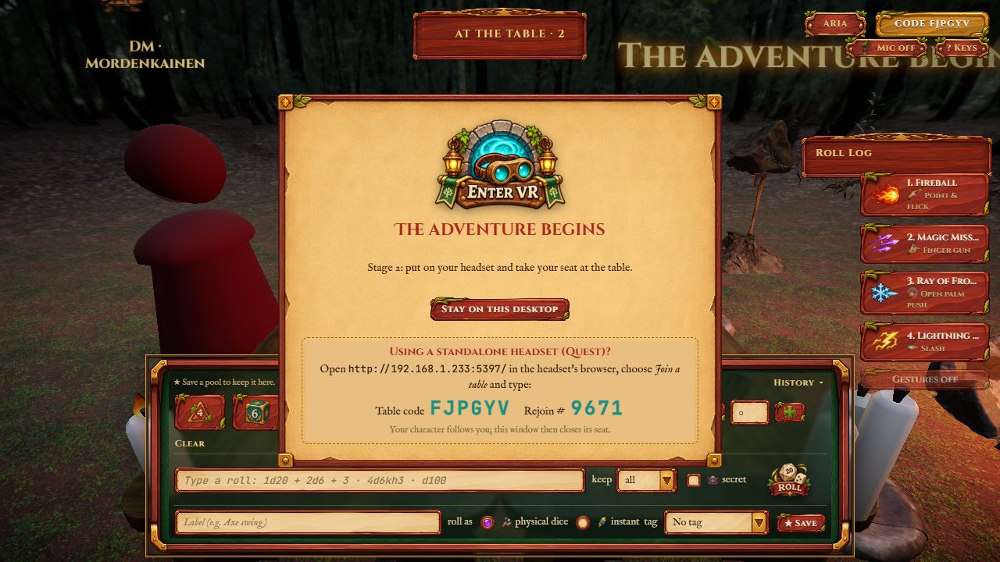

*The address in these screenshots is the test computer's own network address; yours will differ.*

### 4. Play at the table

Everyone sits at their own seat with their own dice tray, character card and satchel. Voices come from each person's seat. The DM places creatures, calls for rolls and changes the world around the table.

| | |
|---|---|
| 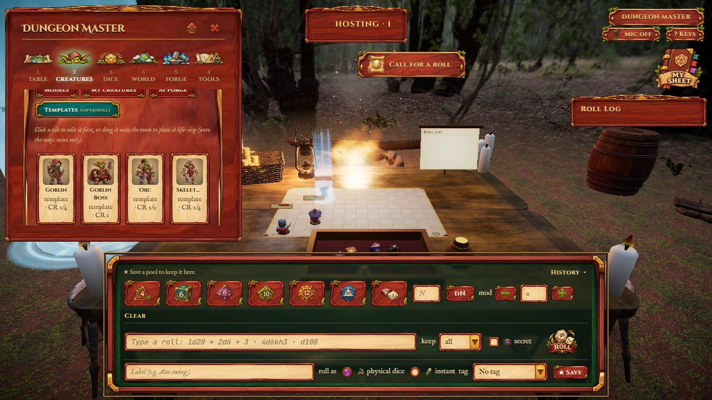 | 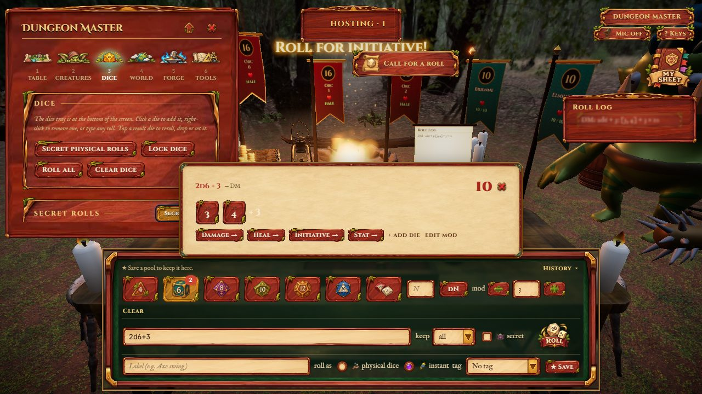 |

---

## How a turn works

The DM decides; the app never enforces a rule it was not asked to.

1. **The DM calls for a roll** (*Call for a roll* at the top of the DM's screen, or the Combat panel in VR): an attack, saving throw, ability check, damage, initiative or anything else, for one player or several, with an optional DC, advantage or disadvantage, and a target.
2. **The player rolls.** A prompt says what is wanted. Throwing the dice by hand answers it (the sheet's modifier is added automatically), or the **Roll** button does.
3. **The DM confirms.** With *Rules assist* on, the card shows hit or miss against the target's AC, success or failure against the DC, and critical hits and fumbles. For damage the DM picks the target and amount (½ and ×2 for resistance and vulnerability; resistances on the sheet are suggested).
4. **The player makes their hand sign.** The target glows. One of the player's four gestures, aimed at it, releases the strike: the effect flies across the table and the damage lands on impact, for everyone at once. On a desktop: the *Unleash* button, `Enter`, or the spell bar.

Nothing changes anyone's hit points before step 4. The DM can also type HP directly (`-7`, `+3`, `=25`, `+5 temp`), release or cancel a strike, and switch gesture release off entirely.

| | |
|---|---|
| 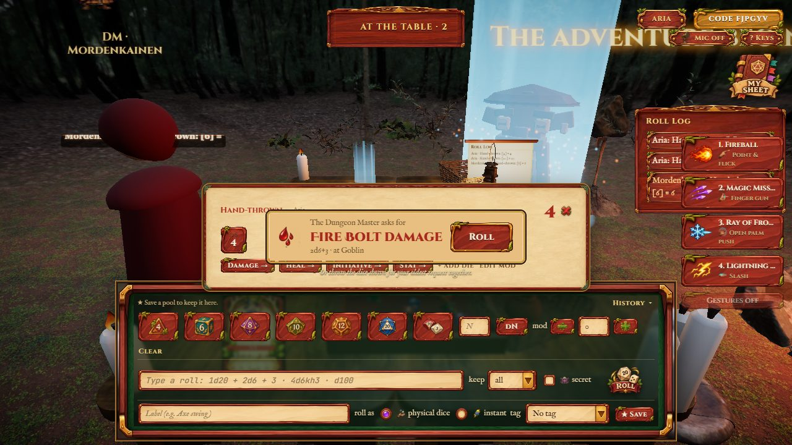 | 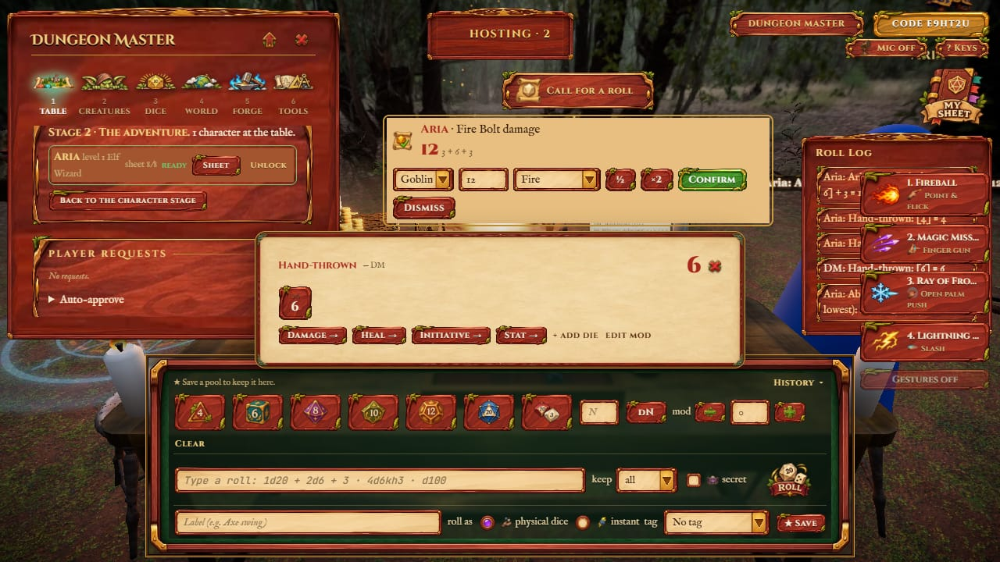 |
| 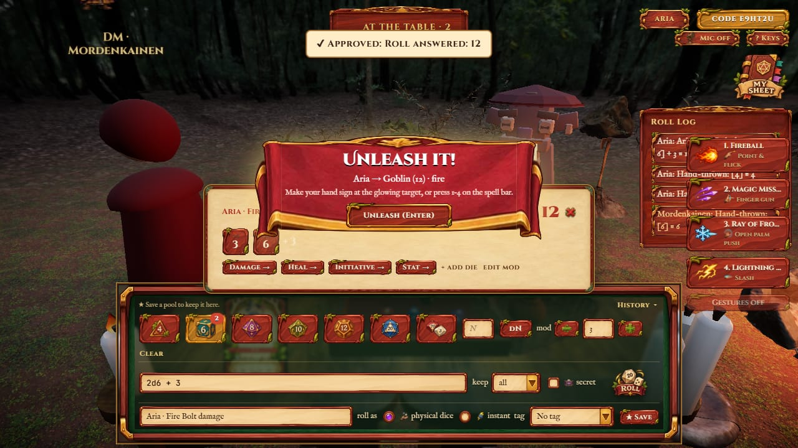 | |

---

## Hand tracking and hand signs

The game reads hands in two ways, and both feed the same dice, grabbing and gesture code:

- **On a Meta Quest:** the game starts an `immersive-vr` WebXR session that requests the `hand-tracking` feature ([src/main.js](src/main.js)), so the Quest Browser sends the 25 tracked joints of each hand every frame ([src/input/XRHandSource.js](src/input/XRHandSource.js)). Pointing at panels uses the Quest's own system hand ray and pinch, the same pointer Meta's menus use ([src/ui/vr/XRPointer.js](src/ui/vr/XRPointer.js)).
- **On a laptop:** Google MediaPipe's Hand Landmarker tracks up to two hands from the webcam and converts them to the same joint format ([src/input/WebcamHandSource.js](src/input/WebcamHandSource.js)). Its model files ship in `public/assets/mediapipe/`, so it works offline.

**The four hand signs:**

| Sign | Move |
|---|---|
| **Point & flick** | Point at the target, then flick the finger forward |
| **Finger gun** | Make a finger gun, then drop the thumb |
| **Open palm push** | Open hand facing the target, push forward |
| **Slash** | Flat hand, swipe edge-first |

Each player pairs each sign with one of 32 spell effects (fire bolt, magic missile, ray of frost, lightning and more). **Hand signs only listen while the DM has confirmed a strike for you**, so moving your hands around never fires anything by accident. Free casting is opt-in (*Gestures on* on the spell bar). The **Practice** panel gives live feedback on each sign and records samples to tune recognition to your hands.

**Physical dice:** pinch or make a fist near a die to pick it up, and let go to throw it. Pinch inside the leather pouch for a fresh d20. The dice are real physics objects (cannon-es), and the face that lands up is the result.

---

## The DM's tools

The DM's dock has six tabs (keys `1` to `6`), and the same tools exist as floating panels in VR. **Expand** (or `Shift+M`) opens the dock full-screen.

- **Table:** invite code and QR, the stage roster, player requests (players can ask for almost any DM action; the DM approves, edits or denies), rules switches, experience awards, party loot split, handouts to chosen players, saved setups, save and load.
- **Creatures:** one gallery with 24 rigged, animated creatures (goblins, skeletons, wolves, a giant spider, a dragon and more), blank models, your saved creatures and forged creatures. Drag a tile onto the room to stand it life-size, or onto the map for a mini. Every stat is editable (HP, AC, speed, abilities, conditions). Also: the token list with health bars, the initiative tracker, and formations (line, arc, surround, scatter).
- **Dice:** any pool, any modifier, keep highest or lowest, secret rolls, saved rolls, history.
- **World:** eight 3D scenes with real props around the table (campfire, castle cellar, crypt rotunda, castle ruins, cliff fortress, forest cave, fey forest, Moonrise Plains), time of day, mood, weather, music, sound effects, narration and fog of war. The battle mat itself never changes.
- **Forge:** describe a creature, approve the picture, get a model (see [AI Forge](#ai-forge-creatures-only)).
- **Tools:** grid snap, ruler, area-of-effect templates.

Rules switches (Table tab; defaults in `src/data/tableDefaults.json`): Rules assist, damage needs the attacker's gesture, monsters strike at once, minis and bodies move together, only the DM moves enemy minis, players see the DC.

| | |
|---|---|
| 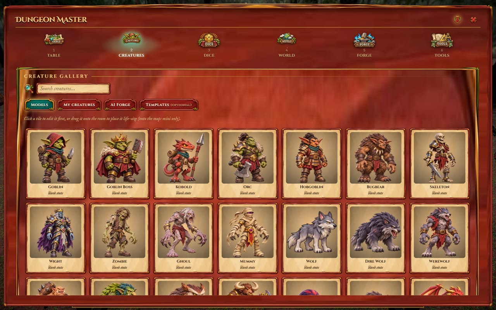 | 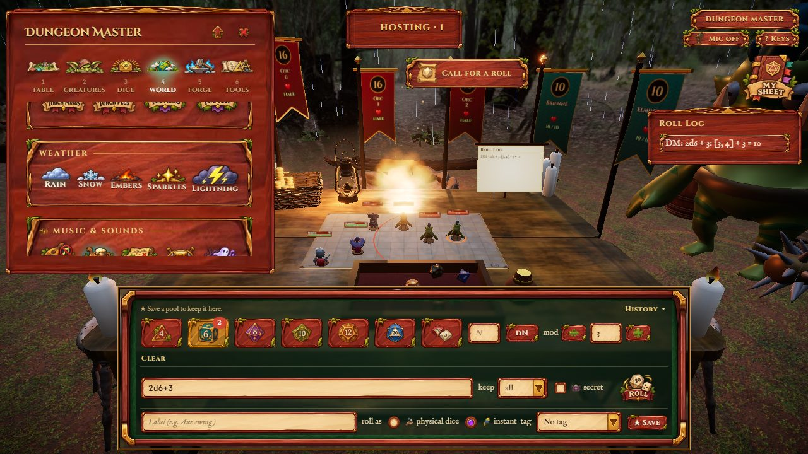 |

---

## The character sheet

The full sheet follows the D&D 2024 character sheet block for block and opens with `K` on a desktop, or by touching your character card on the table in VR. Tabs: **Sheet** (armour class, hit points, hit dice, death saves, abilities, skills, level up, rests), **Spells** (spellcasting ability, save DC, slots, cantrips and prepared spells), **Bag** (coins in copper, silver, electrum, gold and platinum, equipment from the 132-item catalogue, magic item attunement) and **Story**.

| | |
|---|---|
| 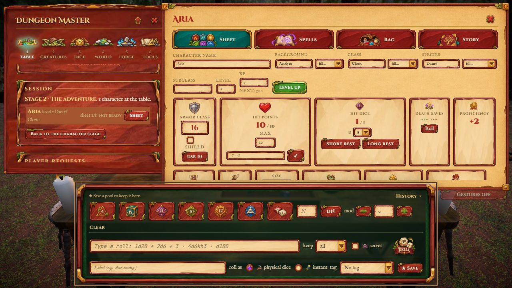 | 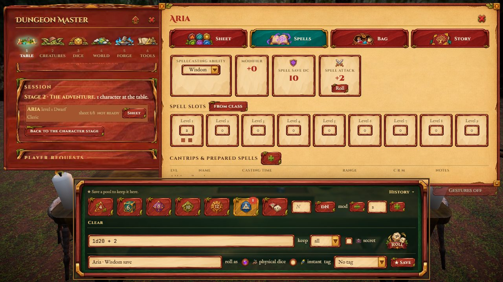 |
| 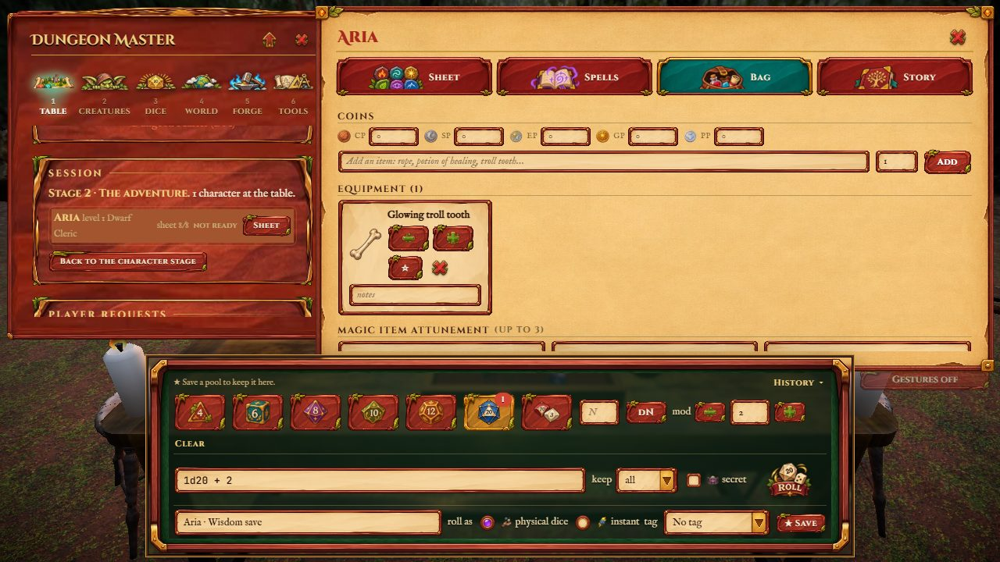 | |

---

## The VR interface

In the headset, panels float in the room instead of sitting on a flat screen. **Look at your left palm** for a moment and the hand menu appears beside your hand. Point and pinch to click, tap buttons with a fingertip, pinch a title bar to move a panel, and pull a panel down past the table edge to close it.

Player panels: Dice · Character · Bag · Spells · Voice · Handouts · Practice. The DM also has Creatures · Combat · Requests · World · Table · Forge · Tools · Edit creature.

| | |
|---|---|
| 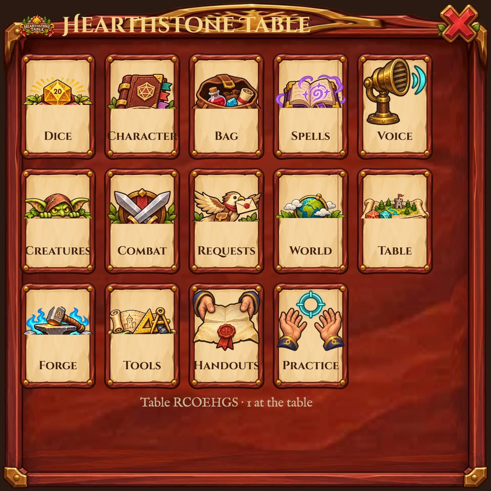 | 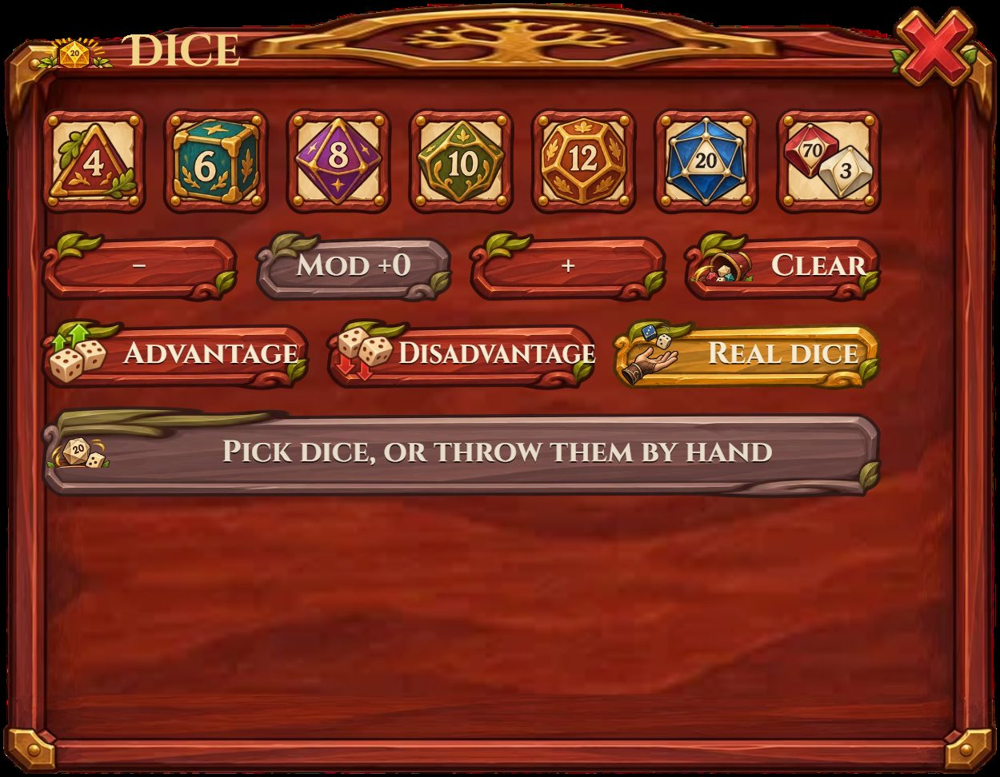 |
| 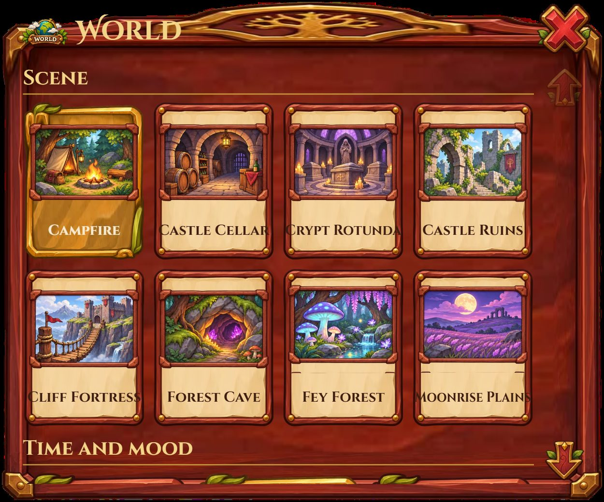 | |

---

## AI Forge (creatures only)

The Forge makes **creatures**: describe one, approve the picture, and it becomes a mini on the map and a life-size body in the room. It does not make items, props, icons or backdrops.

Providers are chosen on the server (`server/ai-forge.js`) from keys in a `.env.local` file at the project root (never committed):

| Key | Images | 3D |
|---|---|---|
| none | Pollinations (may refuse without an account) | cut-out painted standee |
| `FAL_KEY` | FLUX schnell | TRELLIS image-to-3D (GLB) |
| `MESHY_API_KEY` | – | Meshy image-to-3D (GLB) |
| `TRIPO_API_KEY` | – | not finished yet: `tripoModel()` and `tripoRig()` in `server/ai-forge.js` are stubs, so **do not set this key yet** (it would send every 3D job to the stub) |

**Without any key everything else works**: the 24 creatures and the model gallery need no AI.

---

## Voice chat

Click **Mic** (or open the Voice panel in VR). Everyone connects directly to everyone else (WebRTC), so it works on the same network with no extra server. Each voice comes from that person's seat. The DM can switch to an even "narrator" voice and can mute a player. Push-to-talk is optional (`V`).

---

## Controls

**In the headset (hands or controllers)**

| Do this | To |
|---|---|
| Pinch or make a fist near a die or mini (controller: grip) | Pick it up; let go to throw |
| Pinch inside the leather pouch | Pull out a fresh d20 |
| **Look at your left palm** for a moment (controller: menu button) | Open the hand menu; pinch its title to float it |
| Point (the Quest's own hand ray) and pinch, then let go (controller: trigger) | Click: it acts when you let go, on what the pinch started on |
| Tap a button with your index fingertip | Click (the button glows as your finger comes near) |
| Pinch and drag inside a list, or slide a touching finger (controller: thumbstick) | Scroll |
| Pinch and hold a creature row | Open the creature editor |
| Pinch a panel's title bar and move | Drag the panel; pull it down past the table edge to close it (or tap its X; controller: B / Y) |
| Touch your character card or satchel on the table | Open Character or Bag |
| With a confirmed strike: point at the glowing target, hold a sign, then do its move | Release the strike |
| Menu → **Practice** | Practise the signs with live feedback; record samples to tune them to your hands |
| DM: point at a life-size creature and pinch | Drag it across the floor; twist your wrist (or thumbstick) to turn it |
| DM: pinch a creature in the Creatures panel and pull it out | Place it life-size on the floor, or mini-only on the map |

**Desktop**

| Input | Action |
|---|---|
| Left-drag a die or mini | Pick up and fling |
| Click a die / the pouch | Toss it / new d20 |
| `Space`, `1`–`6`, `C` | Roll every die, spawn d4–d20 (players), clear |
| `K` | Character sheet |
| `Shift+1…4`, then click | Cast a hand-sign spell (or release a confirmed strike) |
| `Enter` or `U` | Unleash a confirmed strike |
| `T` | Hide or show the dice tray |
| `V` | Hold to talk (push-to-talk) |
| Arrows / WASD, right-drag, wheel | Turn and zoom |
| DM: `M`, `Shift+M`, `1`–`6` | Dock, full-screen dock, and its tabs: Table · Creatures · Dice · World · Forge · Tools |
| DM: `F` | Paint the fog of war away |
| DM: drag a gallery tile onto the room | Place a creature life-size (onto the map: mini only) |
| DM: drag a life-size creature, wheel while dragging | Move it, turn it |
| `?` or `H` | All shortcuts |
| `P` (test mode) | Switch between DM and player |

---

## Playing on a Meta Quest

1. On the computer, run `npm run dev`. Vite prints a **Network** address such as `https://192.168.x.x:5173`.
2. Put the Quest on the **same Wi-Fi** as the computer.
3. In the Quest Browser, open that Network address and accept the certificate warning (*Advanced → Proceed*).
4. Turn on hand tracking in the headset settings (*Settings → Movement tracking → Hand tracking*). Controllers also work.
5. Host or join the table, then press **Enter VR**.

HTTPS is required on other devices for VR, the microphone and the webcam; `npm run dev` provides it with a self-signed certificate. The computer runs the table server, so it stays on during the session. Only the DM needs a computer: a player can build their character on any phone, tablet or laptop browser, or join straight from the headset.

---

## Project status and roadmap

**Working now:** the full host → join → build → play loop, physical dice, the four hand signs, the DM's tools, voice, and the AI Forge with fal or Meshy keys. Verified in desktop browsers, in Meta's emulated Quest 3, and with simulated webcam hands.

**Not yet verified:** a session on a physical Quest headset with real people; that is the next step.

**Next milestone, one trustworthy encounter:**

- Hand signs cancel cleanly when the hand changes shape, survive short tracking gaps, and behave the same at any frame rate.
- One calibration shared by practice and combat.
- Multi-die progress ("1 of 2 d6 thrown").
- Fog of war kept on save and load.
- Switching input (mouse, webcam, VR) in the middle of a session.
- A Forge pipeline with staged retries and real rigging (Tripo).
- Profiling on a real Quest against the 72 frames per second budget, then playtests with real groups.

---

## Testing and quality (for developers)

```bash
npm run test:unit
```

```bash
npx playwright install chromium
npm run test:e2e
```

| Suite | What it covers | Result |
|---|---|---|
| **Unit tests** (Vitest, 21 files) | Rules, the character sheet, the builder, rooms and codes, the call → roll → confirm → release loop, the arena, gesture recognition, recordings and replays, requests, tokens, dice faces, MediaPipe conversion | **435 passing** |
| **Browser end-to-end tests** (Playwright, 26 tests in 9 files) | Host → join → build → begin → call → roll → confirm → release in two browsers; rejoining from a second device; the DM's critical path; the sheet; the Forge; the headset interface on the emulated Quest; every hand sign through the real gesture pipeline with synthetic hands; webcam hands; voice between two browsers with fake microphones | All 26 pass on a laptop with a graphics card (`E2E_GPU=1`) |
| **Multiplayer soak** | One DM and three players for 60 minutes: 719 rounds, 2,157 snapshot and roll deliveries, 59 reconnects | Every seat, identity and roll kept |
| **Hand-sign matrix** | 1,416 synthetic gesture cases across hands, speeds and frame rates | 624 of 672 clean cases recognised; tuning is the next milestone |
| **Continuous integration** | GitHub Actions runs the unit and browser suites on every push | Unit tests and 21 of 26 browser tests pass there; the 5 tests that run several 3D browsers at once are too heavy for GitHub's machines without a graphics card and are checked locally |

The browser tests need Playwright's Chromium once (the install line above). Set `E2E_GPU=1` to run the browser tests on the graphics card (much faster on a laptop). Recorded-hand replays are described in [harness/README.md](harness/README.md).

---

## How it is built (for developers)

| Layer | Technology |
|---|---|
| Rendering and VR | three.js with WebXR (`immersive-vr`, `hand-tracking`), Meta's IWER emulator for testing |
| Hands | WebXR hand joints on Quest; Google MediaPipe Hand Landmarker for webcams |
| Physics | cannon-es (dice, minis) |
| Multiplayer | a WebSocket room server inside the Vite dev / preview server (codes, rejoin, snapshots, relays) |
| Voice | WebRTC peer-to-peer with positional WebAudio |
| AI | server-side Forge with fal (FLUX, TRELLIS), Meshy and Tripo hooks |
| Build | Vite, vanilla JavaScript modules, no framework |

```
server/   sync.js (rooms, codes, rejoin, relays) · ai-forge.js · ai-jobs.js
src/
  table/   layout (seats, trays) · arena (where creatures stand) · Tactics (grid, ruler, templates) · SpeedRing
  party/   sheet (2024 sheet model) · CharacterSheet · SheetBuilder (stage 1) · bagActions
  combat/  strikes (call → roll → confirm → release) · StrikeFlow · CombatManager · CombatView
  net/     TableSync · Requests · Avatars (remote heads and hands) · Voice
  ui/      kit (painted art) · DMDock + panels · DiceTray · CallCards · Handouts · vr/ (XRPointer, VRUI)
  input/   InputManager · GrabSystem · gestures · castGestures · Caster · XR / webcam / mouse sources
  scene/   Table · SceneManager · LifeDrag · SeatProps · …      scenes/  campfire · hdriBackdrop · setLoader
  data/    classes · origins · items · effects · monsters · models · sets · tableDefaults · kit
tests/    unit/ (Vitest) · e2e/ (Playwright)
harness/  synthetic and recorded hand replays
docs/     Field Guide (PDF) · screenshots/
```

**Production build:** `npm run build` writes `dist/`. Multiplayer and the AI Forge need the server (`npm run dev` or `npm run preview`), not a static host.

---

## Troubleshooting

| Problem | Fix |
|---|---|
| "Your connection is not private" | Expected with `npm run dev` (self-signed certificate). Choose *Advanced → Proceed*. Or use `npm run dev:http` on one computer. |
| The Quest cannot open the address | Same Wi-Fi as the computer; allow Node.js through the Windows firewall on private networks; use the **Network** address, not `localhost`. |
| **Enter VR** is greyed out | The browser has no WebXR device. Use the Quest Browser, or add `?iwer` to the URL to emulate one. |
| Webcam hands do nothing | Allow camera access in the browser, use good light, and keep both hands in view. Webcam hands need `https://` or `localhost`. |
| No AI images | Expected without keys; add `FAL_KEY` to `.env.local` and restart. Everything else works without AI. |
| Port already in use | Close the other dev server, or Vite picks the next free port and prints it. |
| The dice pile up | Press `C` to clear. |

---

## Copyright and credits

Copyright © 2026 Valpixv. All rights reserved. The source is published here so it can be viewed and demonstrated; no licence to copy, modify or redistribute it is granted.

Third-party models, skies, textures, controller profiles, fonts, libraries and rules text keep their own licences (CC0, MIT, SIL OFL, W3C and CC BY 4.0); every source and its required attribution is listed in [ASSETS.md](ASSETS.md).
